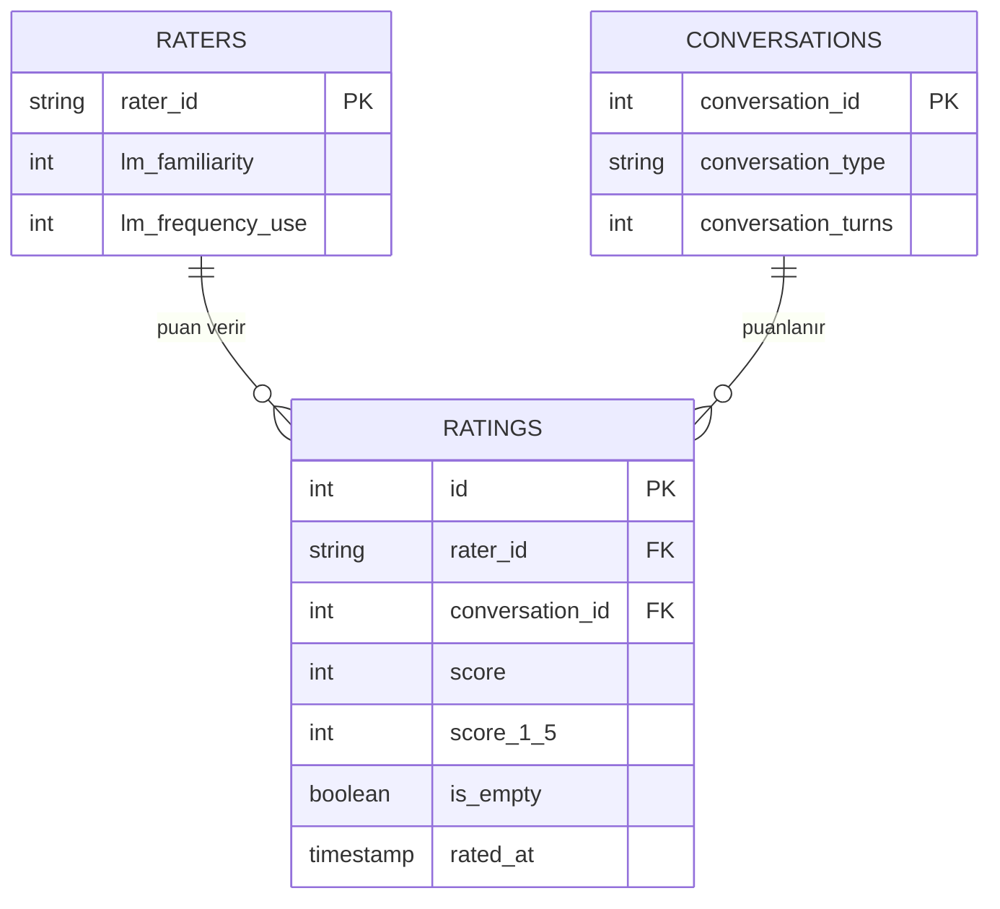

# Veri Kartı: PRISM Alignment Dataset

## Kaynak
- **Veri seti:** The PRISM Alignment Dataset
- **Yazarlar:** Hannah Rose Kirk, Alexander Whitefield, Paul Röttger, Andrew Bean ve diğerleri (University of Oxford ve ortak kurumlar)
- **Yayın:** NeurIPS 2024, Datasets and Benchmarks Track
- **Erişim:** https://huggingface.co/datasets/HannahRoseKirk/prism-alignment
- **DOI:** 10.57967/hf/2113

## Veri setinin amacı
PRISM, büyük dil modellerinin (LLM) insan tercihleriyle uyumlandırılması için toplanmış, kültürel olarak çeşitli bir insan geri bildirimi veri setidir. 1.500 katılımcı önce bir anketi dolduruyor, sonra 21 farklı LLM ile canlı konuşmalar yapıp model cevaplarını puanlıyor.

## Dosyalar ve satır sayıları
| Dosya | Satır sayısı | İçeriği |
|---|---|---|
| survey.jsonl | 1.500 | Her satır bir katılımcının anket cevapları (user_id ile tanımlı) |
| conversations.jsonl | 8.011 | Her satır bir konuşma (conversation_id, user_id ile anketle eşleşir) |
| utterances.jsonl | 68.371 | Her satır tek bir puanlanmış ifade: insan girdisi - model cevabı - puan |

## Senaryoyla ilişkisi
Bu projede senaryo, bir eğitim kurumunun sohbet asistanı cevaplarını birden fazla değerlendiricinin puanladığı ve puanlayıcılar arası tutarlılığın incelendiği bir durumu tarif ediyor. PRISM'deki utterances.jsonl dosyası, aynı mantıkla her bir model cevabına katılımcılar tarafından verilmiş puanları içeriyor; bu nedenle "puanlayıcılar arası tutarlılık" sorusunu incelemeye uygun.

**Not:** PRISM'deki puanlayıcılar (participants) öğretmen değil, genel halktan 1.500 katılımcıdır. Bu veri seti eğitim kurumlarına özgü gerçek bir puanlama sistemi değildir; senaryodaki "öğretmenler" rolü PRISM'in puanlayıcı katılımcılarıyla temsili olarak eşleştirilmiştir.

## Lisans
- İnsan tarafından yazılmış metinler (sorular/istemler dahil): Creative Commons Attribution 4.0 International (CC-BY-4.0)
- Model cevapları: Creative Commons Attribution-NonCommercial 4.0 International (CC-BY-NC-4.0), ayrıca ilgili modeli sağlayan şirketin kendi lisans şartlarına da uyulmalı
- Veri seti araştırma ve eğitim amaçlı kullanım için sağlanmıştır

## Veri üzerinde yapılan değişiklik
Ham veri (survey.jsonl, conversations.jsonl, utterances.jsonl) hiçbir değişiklik yapılmadan, orijinal hâliyle data/raw/ klasörüne kaydedilmiştir.

## Veri Modeli

### ERD

- Bir puanlayıcı (RATERS), sıfır veya çok sayıda puan (RATINGS) verebilir; her puan tam olarak bir puanlayıcıya aittir.
- Bir konuşma (CONVERSATIONS), sıfır veya çok sayıda puanlanmaya konu olabilir; her puan tam olarak bir konuşmaya aittir.

### Normalizasyon notu

| Tablo | Neden ayrıldı / ayrılmadı | Hangi form |
|---|---|---|
| RATERS | `lm_familiarity` ve `lm_frequency_use` yalnızca `rater_id`'ye bağlıdır, konuşmaya değil; eski tek tabloda bu sütunlar her puan satırında tekrar ediyordu (örn. aynı puanlayıcının bilgisi 20+ kez kopyalanıyordu) — bu yüzden ayrı tabloya çıkarıldı. | 2NF |
| CONVERSATIONS | `conversation_type` ve `conversation_turns` yalnızca `conversation_id`'ye bağlıdır, puanlayan kişiye değil; aynı konuşma birden fazla kişi tarafından puanlandığında bu sütunlar tekrarlanıyordu. | 2NF |
| RATINGS | Her satır atomik tek bir puanı temsil ediyor (bir puanlayıcının bir konuşmaya verdiği tek skor); tüm sütunlar (`score`, `score_1_5`, `is_empty`, `rated_at`) doğrudan satırın birincil anahtarına (`id`) bağlı, başka hiçbir sütuna geçişli olarak bağlı değil. | 3NF |

**1NF örneği:** Eski/ham `utterances.jsonl`'de bazı alanlar (ör. birden fazla etiket) tek hücrede virgülle ayrılmış olabilirdi; `ratings` tablosunda her sütun tek bir atomik değer taşıyor (çok değerli alan yok), bu yüzden 1NF sağlanıyor.

**2NF örneği:** Tek tablo senaryosunda varsayımsal bileşik anahtar `(rater_id, conversation_id)` olsaydı, `lm_familiarity` yalnızca `rater_id`'ye (anahtarın bir parçasına) bağlı olduğu için kısmi bağımlılık oluşurdu — bu yüzden RATERS'a ayrıldı.

**3NF örneği:** `conversation_type`, `conversation_id` üzerinden dolaylı (geçişli) olarak `ratings.id`'ye bağlıydı (id → conversation_id → conversation_type); bu geçişli bağımlılığı kırmak için CONVERSATIONS tablosu ayrıldı.